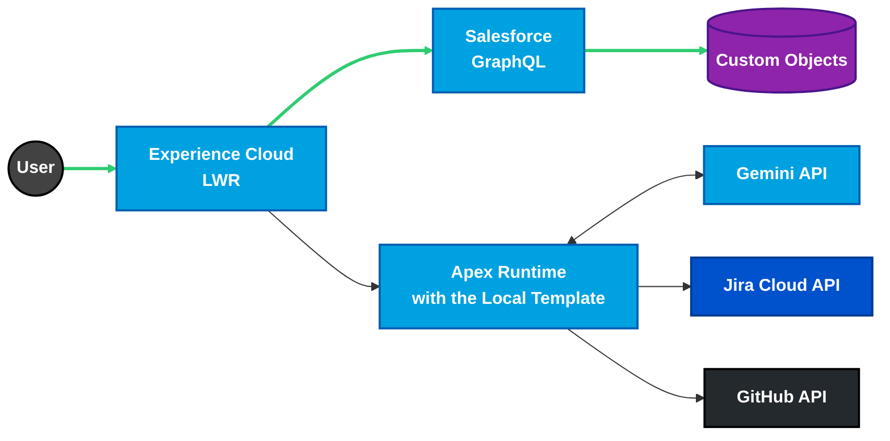
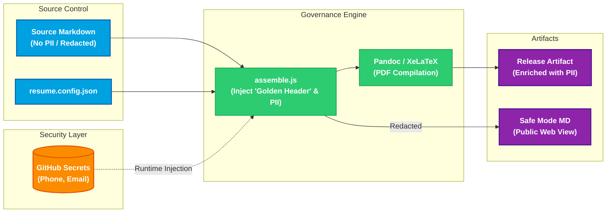

# Hi, I'm Ryan Bumstead

### Senior Solutions Consultant at TELUS Digital | Education Cloud Architecture | Governance-First DevOps
> Architecting Salesforce solutions for higher education institutions and building the governance infrastructure that makes them last.

   

---

### Resumes

**Build one on the live site.** Pick a persona on [ryanbumstead.com/resume](https://ryanbumstead.com/resume) and the skills follow it. The PDF you download matches the preview and comes from the same Salesforce records the site reads.

PDF builds from Resume as Code

> [!NOTE]
> PDFs are generated as release artifacts so contact details never sit in the source. Click a badge to download the latest build.

**Standard Resume**

 

**Comprehensive Resume** *(Technical Deep Dive)*

 

**Platform Engineer Resume**

 

**Recruiter/ATS Optimized Resume**

 

**UX-Focused Resume**

 

---

I guide discovery, architecture, and implementation for Education Cloud engagements at [TELUS Digital](https://www.telusdigital.com/), a Salesforce Summit Partner. My work spans the full student lifecycle including admissions, advising, and student success, with a practitioner foundation built across nearly a decade at higher education institutions.

Outside of client delivery, I build governance infrastructure for Salesforce development teams: tools, protocols, and reference architectures that enforce deployment integrity as a system property rather than a process hope.

**Core Focus Areas:**
- Education Cloud architecture and student lifecycle design
- Governance-driven DevOps and deployment integrity
- Contract-first APIs and integrations that keep working when a dependency fails

### Tech Stack

| Domain | Stack |
| :--- | :--- |
| **Salesforce** | **Apex** · **LWC** · **Experience Cloud (LWR)** · **GraphQL** · **Flow Builder** · **Education Cloud** · **Agentforce** |
| **Integration & AI** | **OpenAPI 3.0** · **Apex REST** · **OAuth 2.0** · **Platform Events** · **Gemini API** |
| **DevOps** | **GitHub Actions** · **Reusable Workflows** · **Salesforce CLI** · **Docker** · **Cloudflare** |
| **Languages & Tools** | **Go** · **TypeScript** · **JavaScript** · **Python** · **YAML** · **Pandoc** · **XeLaTeX** · **Mermaid.js** |

---

### Engineering Highlights

#### [Salesforce Platform Architect Portfolio](https://github.com/rdbumstead/salesforce-platform-architect-portfolio)

   

> *A public website built on Salesforce Experience Cloud, live at [ryanbumstead.com](https://ryanbumstead.com) since October 2026, with its architecture, APIs and delivery pipeline open to inspection.*

> [!TIP]
> **Read the design on the site at [ryanbumstead.com/docs](https://ryanbumstead.com/docs), or in the [Governance Hub](https://rdbumstead.github.io/salesforce-platform-architect-portfolio/).**

* **Architecture on record:** 6 enterprise guides and 34 [Architectural Decision Records](https://github.com/rdbumstead/salesforce-platform-architect-portfolio/tree/main/docs/adr), each marked built, superseded or design only.
* **Contract-first APIs:** a System API and a Process API described in OpenAPI 3.0 (15 and 8 paths), served by Apex REST behind OAuth 2.0 client credentials. Any reviewer can request a short-lived token and call them with curl.
* **Governed AI:** one provider dispatch sends cover letter prompts to Gemini, grounded on portfolio records, and falls back to a deterministic local template when Gemini fails. The page shows which provider wrote each letter.
* **Executable governance:** CI publishes a platform event for every production deploy and heartbeat, and the Delivery page checklist ticks only from that evidence.
* **Observability and resilience:** the Glass Box footer shows live governor limits, daily org quotas and circuit breaker states. A "Simulate an outage" switch shows the cached fallback a visitor would get.
* **Delivery pipeline:** every pull request runs a full scratch org deploy, every local test, a 90% coverage gate and a check only validation against production. Merges ship as delta deploys, and a read only smoke test checks the live site after each deploy and once a day.

#### [GlassOps](https://github.com/glassops-platform/glassops)

 

> *Governance-first Salesforce DevOps, being rebuilt as a CI-agnostic command line tool. Early work, with nothing released yet.*

* **Where it's going:** one CLI that acts as the CI/CD layer for Salesforce delivery, keeping policy enforcement separate from the tools that run the deploy.
* **What runs today:** a Go runtime packaged as a Docker container action. It checks configured freeze windows, can run static analysis, authenticates to an org with the JWT flow, and writes a permit and a deployment contract for the deploy step that follows.
* **History:** the first TypeScript runtime is [archived](https://github.com/glassops-platform/glassops-runtime), and its ideas carry into the rebuild.

#### [Setup Salesforce CLI Action](https://github.com/rdbumstead/setup-salesforce-action)

 

> *A GitHub Action on the Marketplace that sets up the Salesforce CLI for CI/CD pipelines.*

* **Version pinned:** installs the exact CLI version a pipeline asks for, authenticates with JWT and installs the plugins it needs.
* **Cached:** setup takes about 20 to 60 seconds from cache, against 1.5 to 3 minutes cold.

#### ["Resume as Code" CI/CD Pipeline](https://github.com/rdbumstead/resume-as-code)

> *Treating professional career documentation as a software product.*

* **Custom Assembly Engine:** Engineered a Node.js engine that injects job titles ("Golden Headers") and contact details at build time.
* **Secure Secret Injection:** Kept private contact information in GitHub Secrets, apart from the public source.
* **High-Fidelity Compilation:** Orchestrated PDF generation using Pandoc and XeLaTeX.

---

### Certifications

* Salesforce Certified Education Cloud Consultant (Mar 2025)
* Salesforce Certified Data 360 Consultant (Mar 2025)
* Salesforce Certified Agentforce Specialist (Jan 2025)
* Salesforce Certified Marketing Cloud Engagement Foundations (Jan 2025)
* Salesforce Certified Platform App Builder (Sep 2024)
* Salesforce Certified Platform Administrator II (Jul 2024)
* Salesforce Certified Platform Administrator (Jun 2024)
* Salesforce Certified AI Associate (Jul 2024, retired)

[Verify these credentials on Trailhead ↗](https://www.salesforce.com/trailblazer/rbumstead)

### Courses
* MuleSoft DEX-401: Essentials of Anypoint Platform Development

---

**I help organizations evolve from fragile features to resilient, governed ecosystems.**
